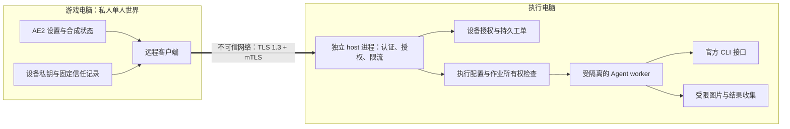
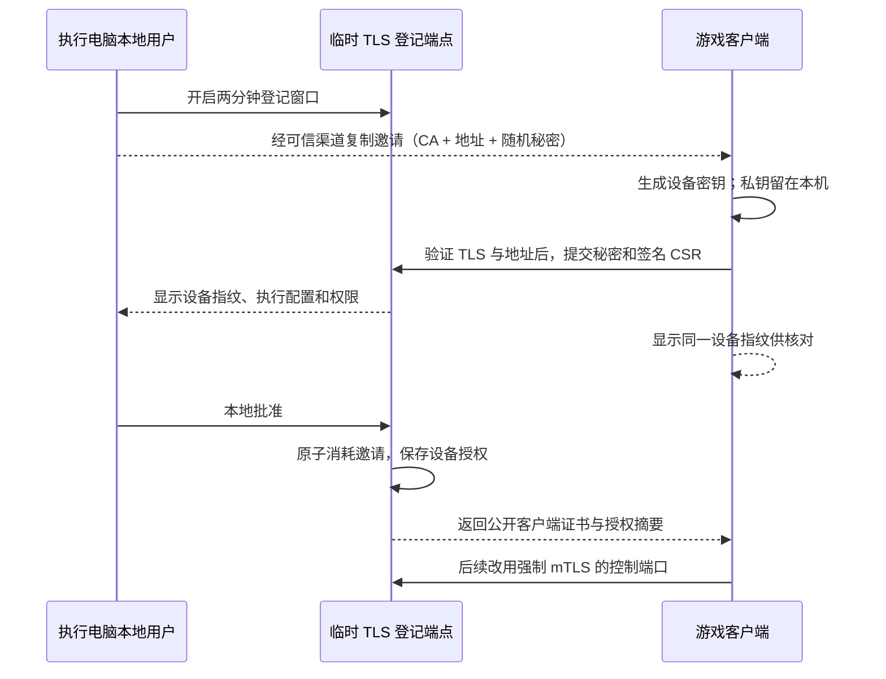

# 远程控制 v2：设计草案与发布条件

日期：2026-11-14。状态：**仅设计，尚未实现或通过安全验收**。当前发行版 0.11.1-alpha 继续仅支持本机；本文不恢复旧协议、旧 host 或旧配对凭据。

English summary: This is a proposal, not an implemented feature. It proposes private-network TLS 1.3, mutual device authentication, local enrollment approval, per-job authorization, bounded resources, and verified worker isolation. Unsupported platform and CLI combinations remain disabled. The current release remains local-only.

## 1. 决策与范围

首版面向私人单人游戏，通过局域网或用户已有的 Tailscale 网络控制自己的另一台电脑。执行端仍可由同一模组 JAR 提供轻量窗口，或由执行端游戏显式启动。不开启公网转发，不运行云中继，不接网页控制端，不接多人权限体系。这里的远控只涵盖 Agent 工单，不含桌面、任意终端或系统控制；首版不接管已在外部终端运行的 Agent 会话。

主方案是 **TLS 1.3 加密、每台设备独立密钥、双向证书认证（mTLS）、执行端本地批准授权**。地址用于寻找机器，设备密钥和本地信任记录用于验证身份。私有 IP、机器名、UUID、Tailscale 地址均不构成身份认证。

| 连接方式 | 首版决定 | 原因或限制 |
|---|---|---|
| 局域网 IPv4 + mTLS | 主方案 | 同一套身份与权限，不依赖公网服务 |
| Tailscale 数字 IPv4 + mTLS | 支持的网络路径 | VPN 负责可达性，应用仍验证设备和权限 |
| SSH | 后续可选路径 | 需额外配置系统 SSH；不因此增加 shell 或转发权限 |
| HTTP + bearer、忽略证书错误 | 拒绝 | 不因“内网”或连接失败而降级 |
| 公网端口、浏览器、OAuth/云中继 | 暂不提供 | 留待单独设计与审计 |

首版只接受规范化的数字 IPv4 地址，不解析任意域名、自动发现地址或学习服务端发来的新路由。IPv6、DNS 地址和反向代理另行验证后再开放。网络管理员仍可能通过 NAT/代理暴露一个私有监听地址，因此地址限制只减少暴露面；加密和认证始终强制执行。

## 2. 玩家看到的流程

1. 在执行电脑打开同一 JAR，或在游戏设置里显式开启“允许本机被连接”。选择允许的 Agent 与执行配置。默认关闭，不因打开存档、收到请求或加载旧配置而开启。
2. 点击“添加设备”，复制一个两分钟内有效的连接邀请。邀请包含地址、公开信任锚和随机秘密，作为一个整体保密，不要求手工输入长串字符。
3. 在游戏的 Agent 设置中粘贴邀请。执行电脑显示待授权设备、设备指纹、允许的执行配置及权限；两端核对设备指纹，在执行电脑确认一次。
4. 本次世界会话显式选择“连接”后才允许远程下单。后续任务在授权范围内自动执行，不逐单弹出批准窗口。
5. 进度、CTX、Tokens、问答、steering、图片和成果继续使用现有 AE2 合成列表与成书，不新增终端右上角状态入口。

主机名称是方便辨认的标签，不是认证依据。改名不换身份；密钥变更必须重新授权。配对失败不把已有机器替换成新机器，也不替换正在执行的任务。

UI 遵循现有 AE2 侧栏、按钮与对齐。连接页显示“未连接／待执行电脑确认／已连接／已撤销／身份变化”。技术参数放在详情中；授权页必须明确说明实际允许读取的范围，不能把普通工作目录称为沙箱。

“断开”停止当前连接；“从列表移除”删除本机记录，不能冒充服务端撤销。执行端提供设备列表、最后连接时间、撤销单设备和“停止全部远程工作”。

## 3. 架构与信任边界

- 游戏客户端、公网/局域网、模型返回值、项目文件、图片、设备名都按不可信输入处理。
- 执行电脑的管理员、OS、选定的 CLI 安装包及其安全更新属于依赖的信任边界。本协议不能抵抗主机管理员或内核被攻破。
- 控制身份密钥、设备授权库与作业数据不进入 Agent 工作目录，不提供给 worker 的环境、文件挂载或日志。
- mTLS 只证明设备持有密钥。每个动作、每段结果和每次重连还必须经过服务端权限检查。
- 恶意项目内容和 prompt injection 即使由已授权玩家间接提交，也不得扩大系统权限。LLM 提示词不参与授权判断。

### 威胁与对应控制

| 威胁 | 必须具备的控制 | 仍需承认的边界 |
|---|---|---|
| 网络窃听、中间人、假主机 | 固定信任锚、标准证书与名称验证、TLS 1.3 | 已失窃的主机私钥需本地轮换并重新配对 |
| 偷取或猜测邀请 | 256 位随机秘密、限时、一次授权、本地核对批准 | 邀请属于秘密；不能放截图、日志或 URL 查询串 |
| 恶意网页、CSRF、DNS rebinding | 不提供网页/跨域接口；拒绝 Origin/浏览器请求标记；数字地址与严格 Host | 这些检查不能代替 mTLS，也不认证通用 HTTP 客户端 |
| 已授权设备越权 | 逐动作授权、执行配置白名单、按设备划分作业 | 授权读取的项目本身可能含敏感数据 |
| 恶意任务读取 host 密钥或其他目录 | OS 级隔离、控制与 worker 分离、文件句柄验证 | `cwd` 和 CLI 的 read-only 模式均不等于隔离 |
| 重放、丢确认、进程崩溃 | 持久幂等作业、操作 ID、明确的 unknown/interrupted 状态 | 不承诺跨任意崩溃的 exactly-once 模型调用 |
| 慢请求、超大输入、连接洪泛 | 握手/头/体截止时间、长度、队列和连接上限 | 应用不能保证抵抗带宽耗尽型 DoS |
| 设备撤销后继续操作 | 授权代次检查、关闭流、取消排队工作并中断 worker | 已发送的数据和已发生的外部操作不可撤销 |

## 4. 传输、证书与首次授权

### 稳定身份

身份密钥与 Host 元数据须原子初始化并锁定单一实例；丢失或损坏时停止，不悄悄重建后沿用旧信任。Host 身份绑定公开密钥，不能用自报 UUID 覆盖。不要在两台执行电脑克隆同一身份；恢复身份备份后须本地重新批准设备授权。

每个执行端首次显式配置时建立专用 CA/身份密钥；使用标准 X.509、PKCS#10 CSR、JCA/JSSE 和维护中的证书库，不自写密码算法、TLS、证书 DER 编码或 PAKE。HTTP 原型优先评估受维护的 Jetty 12 分支配合 JSSE；证书通过维护中的 X.509 库生成。具体依赖版本必须在原型阶段检查维护状态、漏洞公告、许可证并锁定校验值，尚未选定可发布版本。

邀请携带公开 CA 证书；客户端把它安装到**该执行端配置专用**的信任库。正常连接同时验证受信任证书链、用途、有效期、地址对应的 SAN 和已固定的身份。不得使用 trust-all、全局关闭 hostname verification 或修改系统信任库。

绑定地址由执行端用户明确选择，不默认绑定 `0.0.0.0`。证书 SAN 仅由本机允许的地址生成；换地址时可重签服务器叶证书，信任锚不变。新增地址必须在连接管理里显式操作并重新验证，不能由消息、卡片或另一个配对链接静默加入。

客户端到执行端的请求不走系统 HTTP 代理、不跟随重定向、不回退到 HTTP 或本机 Agent。禁用 TLS 0-RTT/early data，认证完成前不处理业务请求；会话恢复不能跳过当前授权检查。首版没有兼容旧明文 host 的开关。

### 分离登记端口与控制端口

正常控制端口在 TLS 握手时强制客户端证书。配对使用临时、仅服务器认证的 TLS 登记端口；后者只在执行电脑打开“添加设备”时存在，没有任务执行、文件读取或配置接口。不能在同一个无需客户端证书的泛用 API 上忘记检查某条路径。

协议约束：

- 邀请随机秘密至少 256 位，只在执行端创建时显示一次；数据库只保存其摘要。邀请总编码长度上限 4 KiB，不压缩，不自动打开深链。Host 重启使所有未完成邀请失效；设备授权和撤销记录独立持久化。
- 验证邀请结构、目标地址和信任锚后，先完成服务器 TLS 验证，再发送秘密；绝不先把秘密交给自报相同 UUID 的机器。
- CSR 必须证明持有设备私钥。服务端忽略 CSR 中请求的 CA 权限、名称和自定义扩展，由本地策略签发 `clientAuth` 叶证书。
- 待确认记录绑定邀请和 CSR 公钥。不同公钥不能替换已显示的待确认设备；设备名不能代替指纹。待确认最多一台，重复的同一 CSR 返回同一请求。
- 批准、邀请消耗、设备公钥、权限和授权代次在同一持久事务中提交。没有登记的证书，即使证书链有效也不能调用任何任务 API。
- 丢失响应时，原 CSR 最多在 30 秒内重取同一公开证书，不创建新授权；之后关闭登记端口。过期、拒绝或撤销也关闭该端口。
- 设备私钥永不传给执行端；执行端私钥永不传给客户端。默认授权最长 30 天，证书续期不能延长授权期限或扩大权限。
- 两端控制私钥须通过系统密钥存储或经过验证的仅所属用户可读存储保护。Windows ACL、macOS/Linux 的实现分别验收，不能因设置权限失败而降级成开放文件。

## 5. 权限与 API

任务 API 使用严格、版本化的类型，不提供任意 `dispatch(action, data)`、远程 shell、终端、文件浏览、任意路径下载、CLI 参数、环境变量、Agent 安装或权限管理接口。

| 动作 | 授权与参数约束 |
|---|---|
| 提交任务 | 设备有 submit 权限；仅能选本地批准的执行配置 ID |
| 查看进度、读取结果/图片 | 设备拥有该作业，且授权仍有效 |
| 回答问题、steer | 拥有该作业；支持该能力；请求对应当前问题/执行轮次 |
| 取消任务 | 拥有该作业，或执行电脑本地管理员操作 |
| 修改工作目录、可执行文件、工具权限、设备列表 | 仅执行电脑本地，不提供网络端点 |

默认只授权观察；执行电脑可一次性授予指定配置的下单、问答、steering 和取消权限。授权升级、增加工作目录或新 Agent 组合必须在执行电脑完成。前端隐藏按钮不是授权措施，服务端逐次检查权限交集。

作业所有者是经过认证的设备身份，不是请求自报的用户名、世界名或可猜的 UUID。持久幂等键至少包含 Host 身份、设备身份和作业 UUID。同键同内容返回原工单，同键不同内容拒绝。操作回执也按设备和作业命名空间划分。

网络数据与 Agent 输出均只作为结构化数据。文本在游戏中按文字渲染，不接受远端提供的 Minecraft clickEvent、命令组件、HTML、脚本或任意 URI。图片接口只接受归属已验证的作业 ID 和内容摘要，逐块复核权限，不返回文件路径或可复用下载令牌。

初版使用有认证的 HTTP 请求加 SSE。原生客户端无需把 token 放到 WebSocket/图片 URL，也无需复制浏览器 cookie、媒体票据和 OAuth 的复杂度。将来如引入其他接口，必须独立限定 audience、scope、有效期和重放规则，不能把一种接口的凭据当成另一种的凭据。

## 6. 执行隔离是单独的发布条件

现有本机适配器的 `read-only`、`cwd` 和工具选择不证明“只能读这个项目”。**不得直接把它们包装成网络服务后声称完成隔离。**

目标配置分为两部分：控制进程持有网络身份和授权库；worker 在独立低权限身份或经过验证的 OS 沙箱中，仅获得工作区只读挂载和每单临时写入区。不能继承用户整个 HOME、SSH agent、云凭据、控制密钥、其他工单、容器管理 socket、任意系统环境变量或可逃逸的项目启动脚本。启动环境使用白名单，排除未批准的 JAVA_TOOL_OPTIONS、NODE_OPTIONS、预加载库和代理设置等可改变子进程行为的项。

模型认证必须逐 CLI 验证。优先使用仅允许既定模型端点的凭据 broker 和每作业受限凭据，禁止通用代理、CONNECT 和客户端指定目的地址。如果官方 CLI 登录方式无法隔离真实模型凭据，就不能把它宣称为“工作区受限的远程执行”；该 CLI/登录组合保持远程执行不可用。调用官方 CLI 接口本身不保证安全隔离。

Linux 先验证低权限用户和 mount/process/network namespace 等隔离；Windows、macOS 需要对应可维护方案及实际测试。没有通过的平台或后端组合只保留本机能力，不能仅弹一个警告就开放受限执行。

worker 网络按执行配置限制；控制身份密钥不可从 worker 文件系统、进程环境、`/proc`、文件描述符别名或子进程中取得。后端扩展、MCP、hooks、项目脚本和子 Agent 不得扩大执行配置权限；默认关闭未经审查的加载途径。

现有本机图片读取的路径预检与实际读取不是原子操作，不能直接作为新远程的竞态防护。图片与附件不能只做字符串前缀、realpath 或“检查 symlink 后再读取”。必须针对已打开的文件句柄验证归属和身份，处理符号链接、Windows reparse point、目录替换、硬链接和检查/使用竞态。优先由受隔离的输出区导出到不可变归档，再以摘要提供读取。平台不能实现或验证这些规则时，不开放相应远程附件功能。

## 7. 持久化、断线与撤销

- 执行端先持久化接单和启动意图，再启动 worker。崩溃边界无法确定是否已执行时显示 unknown/interrupted，不自动重跑模型，不承诺 exactly-once。
- 重连始终回到原 Host 身份与工单。无回复不是失败重跑的理由，不自动切换其他机器或本机。需要重新执行时由玩家明确下新单。
- 世界里只保存非秘密的目标引用和工单 ID；设备密钥和授权存放在电脑本地。导入世界或 NBT 不会自动连接、授权或启用分享；每次世界会话需要私人世界主人显式连接。
- 打开局域网或进入多人模式后停止控制端远程操作。尚不设计多人授予权、转授予权或客户端自报管理员身份。
- 服务端每个请求和流事件检查当前授权代次。撤销持久化后，拒绝新动作，关闭已有连接、停止流、取消该设备排队工作并中断其可管理的 worker。
- 取消或撤销只能终止本软件实际拥有的进程，必须检查进程归属，防止 PID 复用误杀；需要平台进程容器/进程组验证，不能只假定枚举后代总能杀净。中断失败应明确报错，不显示“全部已停止”。
- 暂停接单、断开连接、撤销授权、停止远程工作是不同操作。撤销不回滚已经发送的数据或已经发生的外部调用。
- 游戏内启动的 host 由该游戏管理；退出时停止它。独立窗口启动的 host 有独立生命周期，控制端退出不会冒充已停止它。
- 新配置目录、身份和协议独立于被撤回版本；不导入旧 bearer、配对码或共享开关。正常世界归档及原有本机 Agent 不因此迁移或重跑。

## 8. 初始资源上限（设计默认值，需原型压测）

| 项目 | 上限与失败方式 |
|---|---|
| TCP 连接 | 全局 32 个；已认证设备最多各 4 个；拒绝无限等待队列 |
| 未认证 TLS 握手 | 全局最多 4 个并发；5 秒截止 |
| 请求头 | 8 KiB；3 秒绝对截止 |
| 登记请求体 | 16 KiB；5 秒绝对截止 |
| 普通任务请求体 | 256 KiB；5 秒绝对截止；不接受压缩请求 |
| 已认证请求 | 每设备每分钟 120 次、突发 10 次；下单另设每小时 10 次 |
| SSE | 每设备最多一条；单事件 64 KiB；缓冲最多 128 事件或 1 MiB；10 秒写截止，慢消费者断开 |
| 执行队列 | 每 host 1 个运行、每设备 2 个等待、全局 8 个等待 |
| 执行时限 | 10 分钟执行时间；含等待问题的绝对时限 30 分钟 |
| 图片 | 仅 PNG/JPEG；沿用每单 8 张、单张 2 MiB、尺寸/像素上限及 SHA-256 校验 |
| 配对尝试 | 按地址与全局设置有界限流；不建立无限排队请求或线程 |

鉴权失败尽量在读取正文、解析 JSON、查工单和启动 CLI 之前返回。标准 HTTP 服务必须实际验证头/体/握手/写超时、解析深度、重复 JSON 键、未知字段、请求走私和线程/缓冲区上限，不沿用无请求截止时间的简单阻塞 handler。

Tokens 未上报时保持未知。不能用上下文占用代替用量，也不能把不完整的用量显示当成费用硬上限。费用保护依赖真实可强制的供应商限制、执行时限、并发与队列上限。

日志使用固定事件名与内部 ID。不得输出邀请、私钥、Authorization、完整请求/响应、模型登录凭据、原始工具参数或可复用附件地址。诊断导出需要预览和显式选择，不自动上传。设备标签过滤控制字符和双向文字控制符，避免伪造日志和授权提示。

## 9. T3 Code 参考与实际修复核对

核对基线：[T3 Code `1a12c4a`](https://github.com/pingdotgg/t3code/tree/1a12c4afae998925b4a29417f2dc436c0ccd0969)。参考不是安全背书；没有宣称覆盖全部修复或未公开问题。

| 已阅读的来源 | 对本方案的约束 |
|---|---|
| [Remote architecture](https://github.com/pingdotgg/t3code/blob/1a12c4afae998925b4a29417f2dc436c0ccd0969/docs/internals/remote.md) | 身份独立于地址；UUID descriptor 不证明身份；任务保持原执行端 |
| [Environment authentication](https://github.com/pingdotgg/t3code/blob/1a12c4afae998925b4a29417f2dc436c0ccd0969/docs/internals/environment-auth.md) | 权限由服务端决定；换传输不能扩权；接口受众分离；项目不是 OS 沙箱 |
| [敏感配置改走 bootstrap FD](https://github.com/pingdotgg/t3code/commit/b3bca04caf8449c4d10da1c70cd1f3a0c9070280) | 同 JAR 启动子进程时，通过私有管道提供敏感启动数据；Java 可使用专用 stdin/stdout 管道，不照搬 Node FD 3；不放 argv、URL 或继承环境 |
| [附件与静态路径加固](https://github.com/pingdotgg/t3code/commit/b5188e8ceaee3940d2fb3cd88c8fc2121fef1ae7) 和当前 [AssetAccess](https://github.com/pingdotgg/t3code/blob/1a12c4afae998925b4a29417f2dc436c0ccd0969/apps/server/src/assets/AssetAccess.ts) | 类型/扩展白名单、规范路径和打开文件的身份检查，不能仅做路径前缀过滤 |
| [WebSocket 票据绑定用途](https://github.com/pingdotgg/t3code/commit/3cc31ed27c8956b36cee35a50509fb7c6869592b) | RPC、图片/媒体、登记与本地管理不可复用凭据；初版避免 URL 票据 |
| [配对链接不能添加既有环境的新路由](https://github.com/pingdotgg/t3code/commit/003ccd336dc8c2b9a0cbe62cfc358075e86db28c) | 配对、地址变更分开；拒绝自报相同身份的未知地址；没有静默路由学习 |
| [OpenCode 使用实际解析出的服务密码](https://github.com/pingdotgg/t3code/commit/d796063f78a96c8816196fac3fa5660bebdd99a9) | 外层远控授权不能替代内层 CLI 认证；独立验证 OpenCode 的仅本机监听与实际密码 |
| [Chrome 157 安全更新](https://github.com/pingdotgg/t3code/commit/928dd049e1af868bc93ce12498270bd9ec9292c2) | 不引入其浏览器/Electron 表面；Java、HTTP、TLS、图片库仍需各自维护与漏洞响应 |

T3 当前也保留某些明文 LAN 路径；本方案不采用这些路径。检索到的公开安全公告列表为空，不据此推断“没有漏洞”。本次是有界源码与文档核对，不是 T3 或本项目的完整安全审计。

没有在此文中复制实现代码。后续若适配上游代码，继续保留其 MIT 版权和完整许可，并把新增依赖的许可证、版本和分发内容列入现有包检查。

## 10. 发布门槛：未通过则保持远程关闭

| 测试组 | 必须验证的结果 |
|---|---|
| 加密与身份 | 监听抓包没有秘密/正文；错 CA、错 SAN、过期证书、假 UUID、降级、重定向均失败；换地址不会泄露凭据 |
| 登记 | 错误、过期、重放、并发消费、CSR 换钥、越权扩展、丢确认、重启恢复均不生成额外授权 |
| 浏览器与解析 | 恶意 Origin、null Origin、Sec-Fetch、异常 Host、非数字地址、重复键、畸形 JSON/HTTP 均拒绝 |
| 资源 | 慢头、慢体、TLS 握手堆积、超限正文、慢 SSE 和恶意图片不会产生无限线程、内存或排队 |
| 权限 | 不同设备不能读/取消/steer 对方任务；改目录、改 CLI、转发 shell、换执行模式全部拒绝 |
| 撤销竞态 | 活跃流、排队任务、并发启动和 TLS 会话恢复在撤销屏障后不能发起新授权动作；进程中断失败可见 |
| 文件与 worker | 越目录、symlink/reparse/hardlink、目录替换竞态、HOME/proc/FD/控制密钥读取、项目 hooks 均无法突破声明的隔离 |
| 恢复 | 断线、丢确认和崩溃不自动重跑；旧协议和旧配置不能重启监听；导入世界不能自动连接 |
| 实际流程 | 真实两台电脑完成配对、AE2 下单、问答、steer、断线恢复、取消、成书与图片；凭据与日志另行检查 |
| 发行 | 依赖版本与校验锁定、漏洞检查、许可证、攻击性测试复核、独立安全评审、对应平台验收均完成 |

标准库和成熟依赖不能代替这些测试。测试通过也不意味着不存在未知漏洞；发布说明必须准确列出已验证的平台、CLI 登录方式、隔离范围与剩余限制。

## 11. 实施顺序与当前未决项

1. 先做独立、无模型、不会进入发行包的传输原型，验证证书签发/续期、双端指纹核对、mTLS、撤销和超时。不接真实工作目录或真实模型凭据。
2. 选定并验证 OS 隔离与模型凭据路径；逐 CLI 建立允许的组合。无法满足的组合不开放远程执行。
3. 接持久工单、权限、事件、问答与图片，再接 AE2 UI 和同 JAR 的进程生命周期。
4. 完成攻击性测试、真实两机验收及独立评审，再决定是否发布新 Alpha。不得复活被撤回的旧 JAR 或旧协议。

未决项包括：证书/HTTP 库及版本、各 OS 的密钥与进程隔离实现、四种 CLI 登录方式的凭据隔离能力、网络资源上限的压测结果。它们是实施阻碍，不是用“内网可信”或“只读”跳过的事项。
